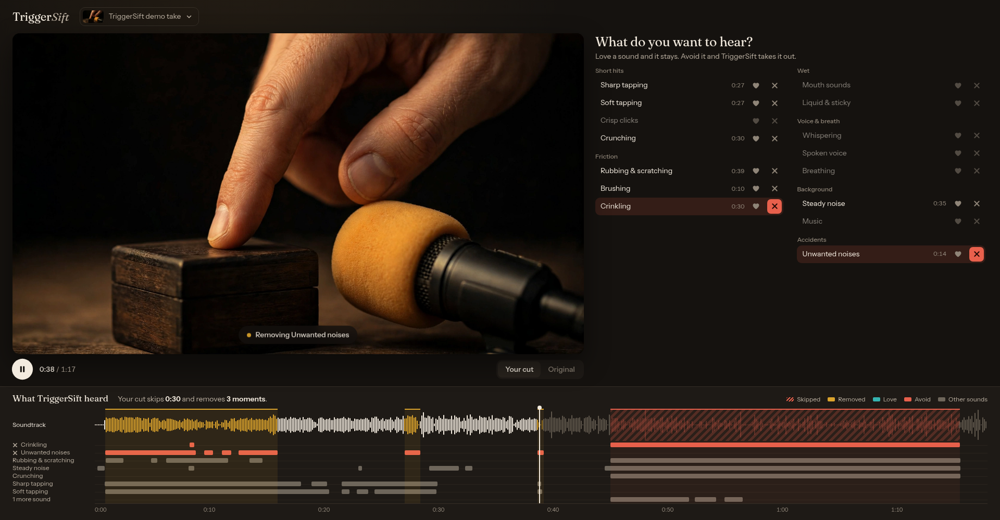

# TriggerSift

**Keep the sounds you came for.**

You've found the perfect ASMR video. Slow tapping, you're almost asleep, and then someone bumps the mic. Or twenty
minutes in, the crinkling starts, and you can't stand crinkling. Everyone has sounds they love and sounds they don't,
and until now your only options were to skip around by hand or give up on the video.

TriggerSift listens to the video first. You tell it what you love and what you'd rather avoid, and it plays your own
version.



## What it does

1. **Pick a video** from your library.
2. **Choose your sounds.** Love it or avoid it, across 15 kinds of sound: sharp tapping, whispering, crinkling, mouth
   sounds, mic bumps and more.
3. **Press play.** The graph shows everything TriggerSift heard and what it will do about it:
   - A long stretch you dislike is **skipped**.
   - A short sound you dislike is **taken out or turned down**, and the video keeps playing.
   - Flip between **Your cut** and **Original** at any moment to hear the difference.

You can also clean up the whole soundtrack, for example to reduce a fan or soften desk thuds.

**A fair warning:** this is an early project. It misses some sounds and mistakes others, and taking a sound out works
best on a clear bump with nothing on top of it. See [Known limits](#known-limits).

## Try it

It runs on your own computer, on videos you already have, and needs an NVIDIA GPU with 16 GB of memory for the local
models. Follow [Run it](#run-it), then open <http://localhost:8000/demo>.

Built for the Meta Global AI Developer Hackathon (Indie track, "Build for Your World"), on Meta's PE-A-Frame,
SAM Audio and Muse Wonder.

---

# The details

## How it works

```
video → PE-A-Frame embeddings (40 ms) → trained classifiers → 15 sound classes on a timeline
                                         (+ Muse Wonder, optional)        │
                                                 your like/dislike profile ┤
                        skip (long, confident) ──────────────────────────┤
                        remove with SAM Audio / mute / duck (short) ──────┤
                        effects on the whole soundtrack ──────────────────┘→ player
```

**Meta models**

| Model | Runs | Role |
|---|---|---|
| **PE-A-Frame** (`facebook/pe-a-frame-large`) | local GPU | Audio embedding every 40 ms. Zero-shot scoring against text, and the features our classifiers are trained on |
| **SAM Audio** (`facebook/sam-audio-large-tv`) | local GPU | Text- and time-prompted removal of one sound, guided by the detector's time spans |
| **Muse Wonder** (Meta Model API) | API, optional | Listens to the audio and looks at frames. In the `combined` detector it decides tapping, brushing, rubbing and liquid |

**What we learned about them**

- Through the API only Muse Wonder hears non-speech audio (MP3 sent inline, plus frames). Muse Spark says it can't,
  and an uploaded video loses its non-speech sound.
- PE-A-Frame embeddings carry far more than its zero-shot scores: small classifiers on top double F1 (below).
- SAM Audio large fits a 16 GB consumer GPU, with a bf16 build, memory-mapped weights and no rankers or span predictor
  (peak 13 GB GPU, 12 GB RAM). Loading it naively peaked around 24 GB of RAM per model and got our session OOM-killed.
- SAM Audio *regenerates* what it returns, so playing its output changes everything in the section. By default we keep
  the original recording and use its two outputs only to decide how far to lower each 20 ms × 47 Hz slice.

**The classes.** We began with ~75 object labels (tapping on wood, on glass…) and dropped them: impossible to label,
impossible to learn, and people's likes follow the sound, not the object. There are now 15 classes of what you *hear*,
such as sharp vs soft tapping (`src/triggersift/taxonomy.yaml`).

## Results

763 hand-labeled clips from 27 YouTube videos, plus FSD50K. Every score comes from a video the model never saw
(leave-one-video-out). The final mix was picked on these same folds, so the numbers are slightly optimistic.

| | Avg AUC | Avg F1 |
|---|---|---|
| PE-A-Frame zero-shot | 0.77 | 0.25 |
| **Trained on our labels + FSD50K** | **0.82** | **0.52** |

| Class | F1 | Class | F1 |
|---|---|---|---|
| Whispering | 0.87 | Clicks | 0.47 |
| Spoken voice | 0.76 | Brushing | 0.43 |
| Crunching | 0.69 | Liquid | 0.43 |
| Soft tapping | 0.59 | Unwanted noises | 0.42 |
| Mouth sounds | 0.59 | Breathing | 0.36 |
| Crinkling | 0.55 | Steady noise | 0.35 |
| Sharp tapping | 0.50 | Rubbing | 0.28 |

Music has too few clips to train on. A 26-minute video is analyzed in about 15 s on an RTX 5070 Ti.

The `combined` detector looks better still, but on a small sample: on the 97 clips (4 videos) with cached Wonder
results, F1 was 0.49 trained, 0.47 Wonder, 0.59 taking the better one per class (chosen on those same clips).

## Known limits

- Detection is far from perfect, and everything downstream depends on it.
- SAM Audio removal works on a clear bump with nothing on top of it. In listening tests it did **not** remove creaks,
  and it fails under a voice, where it takes most of the audio. Mute, duck or the effects are the safer choice there.
- Don't use SAM Audio for steady background: use noise reduction.

## Effects

Rendered once and cached, and they combine. Spike, thud and click tamers judge each moment against its *surroundings*,
not against full scale, so a pop gets caught and the taps you like don't: noise reduction (own spectral subtraction),
thud filter, click tamer, spike tamer, ear-balance guard, silence cleaner, sibilance softener, gentle compression,
tone presets, peak limiter.

## Run it

Needs Python 3.12+, [uv](https://docs.astral.sh/uv/), `ffmpeg`, and an NVIDIA GPU with 16 GB for the local models.
The code expects `.env`, `vendor/` and `datasets/` **next to** the repo folder:

```bash
mkdir triggersift && cd triggersift
git clone https://github.com/Chapet/triggersift app
git clone https://github.com/facebookresearch/perception_models vendor/perception_models
echo 'MODEL_API_KEY=...' > .env        # only for Muse Wonder
cd app && uv sync --extra local
TRIGGERSIFT_LIBRARY=/path/to/videos uv run sift-server   # http://localhost:8000/demo
```

SAM Audio is optional and gated on Hugging Face. It runs in its own environment:

```bash
git clone https://github.com/facebookresearch/sam-audio vendor/sam-audio
git -C vendor/sam-audio apply ../../app/patches/sam-audio-triggersift.patch
uv venv vendor/sam-env && uv pip install --python vendor/sam-env/bin/python -e vendor/sam-audio
```

Three screens: `/demo` is the simple one, `/` is the full player with every detector, removal option and effect, and
`/label` is the labeling tool. `/demo` uses PE-A-Frame zero-shot and SAM Audio by default, and falls back to ducking if
SAM Audio isn't installed; change them with `?detector=` and `?remover=`.

We tested at `perception_models` 3e352cc and `sam-audio` bb4c699. The SAM worker uses `systemd-run` for a RAM cap when available.

Useful commands: `uv run sift analyze|plan|render`, `python -m triggersift.train --fsd --save` (retrain),
`python -m triggersift.harvest` (collect videos with chapters), `python -m triggersift.fsd50k`.

## Data and licenses

Code: MIT. Videos and clips are not in this repo. `trained_heads.npz` holds small classifier weights learned from
embeddings of clips from YouTube videos and from FSD50K (whose clips carry Creative Commons licenses, some
non-commercial), so check those terms before any commercial use. Meta's models keep their own licenses and are
downloaded separately.
